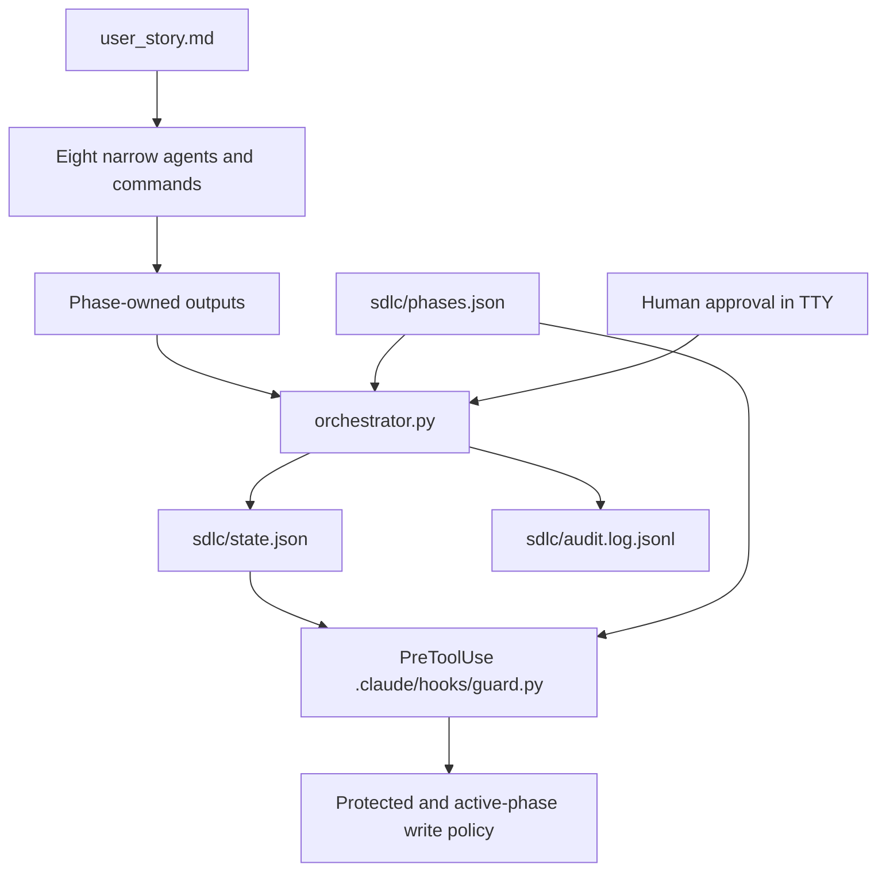

# Notes CLI

A command-line notes manager written in pure Python (standard library only).  
Notes are stored in a local JSON file (`notes.json`).

## Setup

Requirements: Python 3.11 or later.  No external dependencies.

```
# Verify your Python version
python --version
```

The `notes.json` file is created automatically in the working directory on the
first write.  No installation step is needed.

## Usage

The sole supported invocation is `python -m notes.cli`.

### Create a note

```
python -m notes.cli create --title "Shopping list" --content "Milk, eggs, bread"
```

### List all notes

```
python -m notes.cli list
```

Prints each note in the format `[id] title: content`.  
Prints `No notes found.` when the store is empty.

### View a single note

```
python -m notes.cli view --id 1
```

### Update a note (full replace — both title and content are required)

```
python -m notes.cli update --id 1 --title "Grocery list" --content "Milk, eggs, bread, butter"
```

### Delete a note

```
python -m notes.cli delete --id 1
```

Prints `Note 1 deleted.` on success.

## Error handling

Errors (note not found, empty title, empty content, corrupt storage) are
printed to stderr and the process exits with code 1.  No data is modified when
an error occurs.

## Running tests

```
python -m unittest discover -s tests -v
```

---

# Agentic SDLC with Claude Code

This repository demonstrates an eight-phase, human-gated software delivery pipeline driven by Claude Code custom agents. The input is one `user_story.md`; each phase reads approved predecessor outputs, writes only its declared files, submits them, and waits for a human decision.

## What it demonstrates

- Narrow role agents, phase-specific slash commands, and reusable skills.
- A local state machine with submit checks, human confirmation, SHA-256 drift detection, and JSONL audit events.
- A PreToolUse guard for selected dangerous shell commands and writes outside current phase ownership.
- A final release phase with separate preparation and explicitly authorized PR-opening stages.

The sample Todo story keeps the implementation recognizable. The pipeline itself is story-agnostic; only phase 5 names the sample application's files.

## Agentic SDLC

An agent proposes phase work, but it cannot advance the pipeline. A human inspects and approves each submitted result in an interactive terminal. Rejection returns the same phase to ACTIVE; reopening an approved phase is blocked while later outputs remain on disk.

```mermaid
flowchart LR
	R[Requirements] --> HR{Human approval}
	HR --> A[Architecture] --> HA{Human approval}
	HA --> D[Design review] --> HD{Human approval}
	HD --> P[Planning] --> HP{Human approval}
	HP --> I[Implementation] --> HI{Human approval}
	HI --> C[Code review] --> HC{Human approval}
	HC --> V[Verification] --> HV{Human approval}
	HV --> PR[PR Stage A] --> HPR{Human approval}
	HPR --> G[Human says go] --> B[PR Stage B]
	HR -. reject .-> R
	HA -. reject .-> A
	HD -. reject .-> D
	HP -. reject .-> P
	HI -. reject .-> I
	HC -. reject .-> C
	HV -. reject .-> V
	HPR -. reject .-> PR
```



## Architecture



## Who does what

| Phase | Agent | Command | Output |
|---|---|---|---|
| requirements | requirements | `/run` | `artifacts/requirements.md` |
| architecture | architecture | `/run` | `artifacts/architecture.md` |
| design review | design-review | `/run` | `artifacts/design-review.md` |
| planning | planning | `/run` | `artifacts/implementation-plan.md` |
| implementation | implementation | `/run` | `notes/` and `tests/test_notes.py` |
| review | review | `/run` | `artifacts/review.md` |
| verify | verify | `/run` | `artifacts/verify.md` |
| PR | pr | `/pr` | `artifacts/pr.md`, `CHANGELOG.md`, then optional Stage B |

Eight execution agents live in `.claude/agents/`. Two slash commands handle all phases: `/run` routes phases 1–7 through the orchestrator agent; `/pr` manages the two-stage pull-request phase. Verification and PR methods are under `.claude/skills/`.

## Controls

| Control | Enforces | Does not guarantee |
|---|---|---|
| Orchestrator | Valid phase order, owned artifact presence, traceability, human TTY confirmation, hashes, audit entries | Resistance to a determined local user editing code/state directly |
| PreToolUse guard | Selected destructive commands, approval commands, protected paths, non-active owned writes | Complete shell parsing or protection when hooks are disabled/timed out |
| Agent and command scope | Role-specific instructions and allowed files | Model behavior outside effective tool enforcement |

Submit rules include defined FR/NFR IDs, no undefined references, and required phase checks (requirements FR/open questions, design verdict, review/PR complete ID coverage, and verification code fence). Hashes cover only each phase's owned files.

## Repository layout

```text
.
├── .claude/agents/          # Eight phase agents
├── .claude/commands/        # Two slash commands: /run and /pr
├── .claude/hooks/           # Guard and its operator notes
├── .claude/settings.json    # Hook registration and permissions
├── .claude/skills/          # Verification and PR methods
├── artifacts/               # .gitkeep now; phase outputs after live run
├── docs/CONTRACT.md         # Single source of truth
├── docs/RUNBOOK.md
├── orchestrator.py
├── sdlc/phases.json         # Manifest; state/audit initialized at runtime
├── tests/                   # Infrastructure tests; app tests after live run
├── tools/audit_repo.py      # Read-only clean-state audit
└── user_story.md
```

## Quick start

Requirements: Python 3.11+, Claude Code CLI or desktop app. Network access is not used by the app. GitHub CLI, an `origin` remote, and authentication are needed only for PR Stage B.

```powershell
python orchestrator.py status
python -m unittest discover -s tests -v
python -m compileall -q .
python tools/audit_repo.py
python orchestrator.py next
```

The audit is for the clean pre-run state and intentionally fails after live phase outputs are produced. Follow [docs/RUNBOOK.md](docs/RUNBOOK.md) to run each `/phase`, review its output, and approve it yourself in a separate terminal.

## See the controls refuse

```powershell
python orchestrator.py submit architecture
echo '{"tool_name":"Bash","tool_input":{"command":"git reset --hard"}}' | python .claude/hooks/guard.py
python orchestrator.py check
```

The first command is blocked while architecture is LOCKED. The hook demo should deny R03 and exit 2. A changed approved artifact makes `check` report hash drift. Use a disposable copy for tamper demonstrations.

## Known limitations

- The guard is demo-grade and its shell parsing is necessarily incomplete; hook payloads vary by surface.
- Approval is bypassable by a determined user with local filesystem access.
- The audit log is append-only by convention, not tamper-proof.
- Hashes cover only owned files; they do not establish who authored them.
- Stage B requires a valid Git root, remote, branch, and signed-in `gh` CLI.
- End-to-end tests simulate human approval through the importable API; they do not prove a human was present.
- Tests and support tools are not themselves hook-protected.

## Commands

| Command | Purpose |
|---|---|
| `python orchestrator.py status [--json]` | Show phase state |
| `python orchestrator.py next` | Show the active prompt or pending approval |
| `python orchestrator.py submit <phase>` | Validate and submit active outputs |
| `python orchestrator.py approve <phase> --by <name>` | Human-only approval with TTY confirmation |
| `python orchestrator.py reject <phase> --reason <text>` | Return a pending phase to ACTIVE |
| `python orchestrator.py reopen <phase> --reason <text>` | Reopen an approved phase when later outputs are removed |
| `python orchestrator.py check` | Check state, drift, locked outputs, and protected paths |
| `python -m unittest discover -s tests -v` | Run standard-library tests |
| `python -m compileall -q .` | Compile Python files |
| `python tools/audit_repo.py` | Audit clean pre-run structure |
