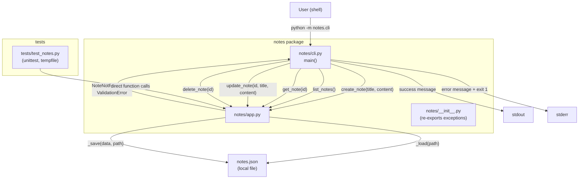

# Architecture

## Overview

The Notes CLI is a three-module Python package (`notes/`) backed by a single local JSON file (`notes.json`). A thin CLI layer translates subcommands into calls to an application layer that owns all domain logic and storage I/O. There is no network surface, no external dependency, and no state outside the JSON file and the process's stdout/stderr.

All seven functional requirements (FR-001 – FR-007) and all six non-functional requirements (NFR-001 – NFR-006) are satisfied within the four files owned by the implementation phase:
`notes/__init__.py`, `notes/app.py`, `notes/cli.py`, `tests/test_notes.py`.

---

## Components and responsibilities

### `notes/__init__.py`
- Package marker; exposes `NoteError`, `NoteNotFoundError`, and `ValidationError` at the package level so tests and external callers can import them without coupling to internal module paths.
- No business logic.

### `notes/app.py`
Owns all domain logic and all file I/O. Divided into two layers internally:

**Storage helpers** (private, not part of the public contract):
- `_load(storage_path: str) -> dict` — reads `notes.json`; returns `{"next_id": 1, "notes": []}` if the file does not exist (NFR-001).
- `_save(data: dict, storage_path: str) -> None` — atomically writes the data dict to `notes.json`; creates the file on first call (NFR-001).

**Public application functions** (called by `cli.py` and by tests):
- `create_note(title: str, content: str, storage_path: str = "notes.json") -> dict` — validates inputs (FR-007, NFR-005), assigns `next_id`, increments it, persists, returns the new note dict (FR-001, NFR-003).
- `list_notes(storage_path: str = "notes.json") -> list[dict]` — loads and returns all notes; empty list when none exist (FR-002).
- `get_note(note_id: int, storage_path: str = "notes.json") -> dict` — returns matching note; raises `NoteNotFoundError` if absent (FR-003, FR-006, NFR-005).
- `update_note(note_id: int, title: str, content: str, storage_path: str = "notes.json") -> dict` — validates inputs (FR-007), finds note (FR-006), performs full replace, persists, returns updated dict (FR-004, NFR-005).
- `delete_note(note_id: int, storage_path: str = "notes.json") -> None` — finds note (FR-006), removes it from the list, persists; `next_id` is not decremented (FR-005, NFR-003).

**Exception hierarchy** (defined in `app.py`, re-exported from `__init__.py`):
- `NoteError(Exception)` — base class for all domain errors.
- `NoteNotFoundError(NoteError)` — note ID absent (FR-006).
- `ValidationError(NoteError)` — empty title or content (FR-007).

### `notes/cli.py`
- Defines `main() -> None` as the entry point; invoked via `python -m notes.cli` or a `console_scripts` entry point.
- Uses `argparse` with one top-level parser and five subparsers (NFR-002):

| Subcommand | Arguments | App function called |
|------------|-----------|---------------------|
| `create`   | `--title TEXT`, `--content TEXT` | `create_note` |
| `list`     | _(none)_  | `list_notes` |
| `view`     | `--id INT` | `get_note` |
| `update`   | `--id INT`, `--title TEXT`, `--content TEXT` | `update_note` |
| `delete`   | `--id INT` | `delete_note` |

- On success, prints a human-readable summary to stdout.
- Catches `NoteError` subclasses, prints the exception message to stderr, and exits with code 1 (NFR-005).
- Prints an empty-list indication when `list_notes` returns `[]` (FR-002).

### `tests/test_notes.py`
- `unittest.TestCase` subclass; each test method creates an isolated temporary file via `tempfile.NamedTemporaryFile` so tests never share state.
- Covers FR-001 through FR-007 explicitly; test method names embed the FR IDs (NFR-004).
- Does not test CLI formatting; tests call application functions directly.

---

## Data model and persistence

### Note object (in-memory and on-disk)
```
{
  "id":      <int>   -- unique, auto-increment, never reused (NFR-003)
  "title":   <str>   -- non-empty (FR-001, FR-007)
  "content": <str>   -- non-empty (FR-001, FR-007)
}
```

### `notes.json` file schema
```
{
  "next_id": <int>,       -- next ID to assign; starts at 1; only ever increments (NFR-003)
  "notes":   [ <note>, ... ]  -- ordered list of note objects (FR-002)
}
```

- File is created automatically on first write (NFR-001).
- Path is `notes.json` in the working directory by default; overridable via the `storage_path` parameter (used in tests).
- An absent file is treated as empty state — `_load` returns `{"next_id": 1, "notes": []}` — rather than an error (NFR-001).
- `next_id` persists across process restarts, guaranteeing ID uniqueness even after deletions (NFR-003).

### Auto-increment ID algorithm
1. `_load` reads `next_id` from the file (or defaults to 1).
2. `create_note` sets `new_note["id"] = data["next_id"]` then increments `data["next_id"]`.
3. `_save` writes the updated `next_id` atomically with the rest of the data.
4. `delete_note` never modifies `next_id`.

---

## Control/data flow

```
User (shell)
    |
    | python -m notes.cli <subcommand> [args]
    v
notes/cli.py  main()
    |  argparse parses subcommand + arguments
    |  calls app function with validated arg types
    v
notes/app.py  create_note / list_notes / get_note / update_note / delete_note
    |  _load(storage_path) -> dict
    |  applies domain logic; raises NoteNotFoundError or ValidationError on failure
    |  _save(data, storage_path) on mutating operations
    |  returns result dict / list / None
    v
notes/cli.py  formats result -> prints to stdout
              catches NoteError -> prints message to stderr, sys.exit(1)
    |
    v
User (shell)  reads stdout / checks exit code
```

---

## Mermaid diagram



---

## Decisions

| Decision | Choice | Rationale | FR/NFR |
|----------|--------|-----------|--------|
| Single `app.py` for storage + logic | No separate `storage.py` | Keeps file count within implementation ownership; two concerns are tightly coupled | NFR-001, NFR-004 |
| `storage_path` parameter on every app function | Dependency injection via parameter | Allows tests to use temp files without patching globals | NFR-004 |
| `next_id` field in JSON | Explicit persisted counter | Guarantees no ID reuse after deletion even across restarts; `max(id)+1` would fail on an empty list and could theoretically reuse IDs if the list were manipulated externally | NFR-003 |
| `argparse` subparsers | One subparser per operation | Standard library; provides `--help` per subcommand and clear error messages for missing arguments | NFR-002, NFR-005 |
| Exception hierarchy under `NoteError` | `NoteNotFoundError`, `ValidationError` | CLI can catch the base class for uniform handling; callers can catch specific subtypes for finer control | FR-006, FR-007, NFR-005 |
| Tests call app functions directly | No CLI subprocess in tests | Faster, no shell dependency, easier to assert return values and exceptions | NFR-004 |
| Full-replace update semantics | Both fields mandatory | Matches the constraint from Human answer 4; prevents accidental partial updates | FR-004 |

---

## Error handling

| Error condition | Where raised | Exception type | CLI behavior |
|----------------|-------------|----------------|--------------|
| Empty title or content on create/update (FR-007) | `app.py` validation at start of `create_note` / `update_note` | `ValidationError` | Print `"Title must not be empty"` or `"Content must not be empty"` to stderr; exit 1 |
| Note ID not found on view/update/delete (FR-006) | `app.py` after scanning notes list | `NoteNotFoundError` | Print `"Note not found: <id>"` to stderr; exit 1 |
| `notes.json` absent on read | `_load` returns default dict | _(no exception)_ | Normal flow; treated as empty storage |
| `notes.json` corrupt JSON | `json.JSONDecodeError` propagates | _(stdlib)_ | CLI allows it to propagate; user sees Python traceback — out of scope per constraints |
| No subcommand supplied | `argparse` | _(stdlib)_ | `argparse` prints help and exits 2 |

Mutating operations (`create`, `update`, `delete`) write to disk only after all validation succeeds, ensuring no partial state is persisted on error (FR-006, FR-007).

---

## Requirement coverage table

| Requirement | Satisfied by |
|-------------|-------------|
| FR-001 Create note | `app.py::create_note`; `cli.py` `create` subcommand |
| FR-002 View all notes | `app.py::list_notes`; `cli.py` `list` subcommand with empty-list indication |
| FR-003 View note by ID | `app.py::get_note`; `cli.py` `view` subcommand |
| FR-004 Update note | `app.py::update_note`; `cli.py` `update` subcommand |
| FR-005 Delete note | `app.py::delete_note`; `cli.py` `delete` subcommand |
| FR-006 Error on non-existent note | `NoteNotFoundError` raised in `get_note`, `update_note`, `delete_note`; caught in CLI |
| FR-007 Invalid input rejection | `ValidationError` raised at top of `create_note`, `update_note`; caught in CLI |
| NFR-001 JSON persistence | `_load` / `_save` in `app.py`; file auto-created; `next_id` survives restarts |
| NFR-002 CLI interface | `argparse` subparsers in `cli.py`: `create`, `list`, `view`, `update`, `delete` |
| NFR-003 Auto-increment IDs | `next_id` field in JSON; incremented on create, never decremented |
| NFR-004 Automated tests | `tests/test_notes.py` with `unittest`; test IDs map to FR IDs |
| NFR-005 Informative error messages | `NoteNotFoundError` and `ValidationError` carry descriptive messages; CLI prints to stderr |
| NFR-006 README documentation | README (owned outside this phase) documents all CLI subcommands; architecture specifies subcommand names |
