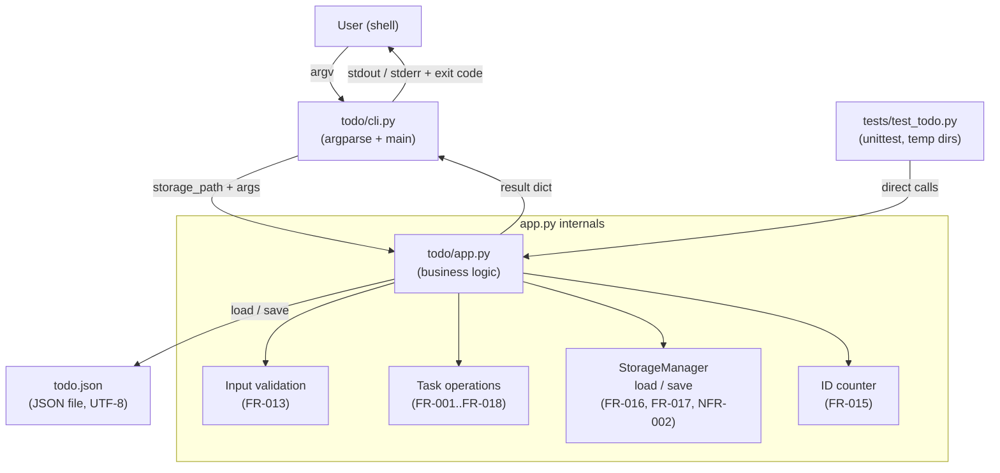

# Architecture

## Overview

The system is a personal todo-list command-line application implemented in pure Python 3.11+ with no third-party dependencies. It is structured as a two-layer package (`todo/`) with a thin CLI presentation layer and an application logic layer that owns all state transitions and storage I/O. A single JSON file on the local filesystem provides persistence.

The contract (phase 5) lists exactly four implementation files: `todo/__init__.py`, `todo/app.py`, `todo/cli.py`, and `tests/test_todo.py`. All architectural decisions stay within those boundaries.

---

## Components and responsibilities

### `todo/__init__.py` — Package initializer
- Marks the `todo` directory as a Python package.
- Optionally re-exports the public API surface of `todo/app.py` to simplify import paths for tests.
- Contains no business logic.

### `todo/app.py` — Application layer
This module is the authoritative home for all business logic and storage I/O.

Responsibilities:
- **StorageManager** (logical grouping within the module): reads and writes the JSON file; handles the missing-file and empty-file cases (FR-017); enforces UTF-8 encoding (NFR-002); exposes `load(path) -> dict` and `save(path, data) -> None`.
- **Task operations** (one callable per operation group):
  - `create_task(storage_path, title, description)` — FR-001, FR-002, FR-013, FR-014, FR-015
  - `list_tasks(storage_path, status_filter)` — FR-003, FR-004, FR-005
  - `update_task(storage_path, task_id, title, description)` — FR-006, FR-012, FR-013
  - `delete_task(storage_path, task_id)` — FR-007, FR-012
  - `mark_completed(storage_path, task_id)` — FR-008, FR-009, FR-012
  - `mark_pending(storage_path, task_id)` — FR-010, FR-011, FR-012
- **Input validation**: whitespace-stripping and empty-title rejection (FR-013) happens inside each write operation before any storage read.
- **Return contract**: every callable returns a result object (a plain `dict` or named tuple) containing at minimum a boolean `success` flag, a string `message`, and (where applicable) the affected task dict. No printing occurs in this layer; this is the primary testability seam (NFR-004).
- **ID counter management**: the `next_id` field in the JSON data is read, used, and incremented atomically within each `create_task` call (FR-015, FR-016).
- **No network calls, no secrets** (NFR-003).

### `todo/cli.py` — CLI entry point and presentation layer
Responsibilities:
- Defines the `main()` entry point invoked by `python -m todo` or a console-script.
- Uses `argparse` (standard library) to parse the command and its arguments.
- Resolves the storage file path (default: `todo.json` in the current working directory; the path is passed down — never hardcoded inside `app.py`).
- Calls the appropriate `app.py` function and receives its result dict.
- Prints the `message` field to `stdout` for successes and informational no-ops (FR-009, FR-011) or to `stderr` for errors (FR-012, FR-013).
- Sets the process exit code: `0` for success and informational no-ops, `1` for error conditions.
- Contains no business logic; all validation and state decisions live in `app.py`.

### `tests/test_todo.py` — Automated test suite
Responsibilities:
- Uses `unittest` exclusively (NFR-004).
- Each test class or method name cites the FR/NFR ID it exercises (NFR-004).
- Uses `tempfile.TemporaryDirectory` to create isolated storage paths; never modifies the user's working directory (NFR-004).
- Calls `app.py` functions directly (bypassing the CLI) to test logic in isolation.
- Also tests the CLI via `subprocess` or `argparse`-level invocation for integration-level coverage.

---

## Data model and persistence

### JSON schema

```json
{
  "next_id": 3,
  "tasks": [
    {
      "id": 1,
      "title": "Buy milk",
      "description": "",
      "status": "pending"
    },
    {
      "id": 2,
      "title": "Read book",
      "description": "Chapter 5",
      "status": "completed"
    }
  ]
}
```

| Field | Type | Notes |
|---|---|---|
| `next_id` | integer ≥ 1 | The ID that will be assigned to the next created task. Never decremented. Persists across restarts (FR-015). |
| `tasks` | array | Ordered list of task objects; creation order is preserved by append semantics (FR-003). |
| `tasks[].id` | integer | Unique, positive, auto-incremented, never reused (FR-015). |
| `tasks[].title` | string | Non-empty after trimming (FR-013). Stored trimmed (FR-001, FR-006). |
| `tasks[].description` | string | Defaults to `""` when omitted (FR-002). |
| `tasks[].status` | `"pending"` or `"completed"` | Only these two values are valid (constraints). |

### Storage file location
- Default filename: `todo.json`, resolved relative to the current working directory at runtime.
- The path is accepted as a parameter by every `app.py` function, enabling tests to substitute a temporary path without monkey-patching (NFR-004).

### Missing / empty file handling
- If the file does not exist: treat as `{"next_id": 1, "tasks": []}` (FR-017).
- If the file exists but is empty or contains only whitespace: treat as `{"next_id": 1, "tasks": []}` (FR-017).
- If the file exists but contains malformed JSON: surface an error message (FR-018) and do not overwrite; this is an unrecoverable state the user must resolve manually.

### Write strategy
- Load the current data, apply the in-memory mutation, then write back atomically.
- No partial-write concern is defined for concurrent access (constraint: no concurrent-writer guarantee).

---

## Control/data flow

### Invocation path (happy path, create example)

1. The user executes `python -m todo create "Buy milk"`.
2. `todo/cli.py:main()` is called; `argparse` identifies the `create` sub-command and extracts `title="Buy milk"`, `description=""`.
3. `cli.py` resolves `storage_path` (default `todo.json` in cwd) and calls `app.create_task(storage_path, "Buy milk", "")`.
4. `app.create_task` validates the title (strip, check non-empty — FR-013).
5. `app.create_task` calls `load(storage_path)` → returns `{"next_id": 1, "tasks": []}` (missing file case — FR-017).
6. Assigns `id = next_id` (1), appends the new task record, increments `next_id` to 2.
7. Calls `save(storage_path, data)` — writes UTF-8 JSON (NFR-002, FR-016).
8. Returns `{"success": True, "message": "...", "task": {...}}`.
9. `cli.py` prints the message to `stdout` and exits with code 0 (FR-018).

### Error path (task not found)

1. User executes an operation targeting a non-existent task ID (e.g., delete ID 99).
2. `cli.py` calls the corresponding `app.py` function.
3. `app.py` loads storage, searches for ID 99, finds nothing.
4. Returns `{"success": False, "message": "Task 99 not found."}` — no write occurs (FR-012).
5. `cli.py` prints the message to `stderr` and exits with code 1.

### Idempotent no-op path (FR-009, FR-011)

1. User marks an already-completed task as completed.
2. `app.mark_completed` loads storage, finds the task, observes status is already `"completed"`.
3. Returns `{"success": True, "message": "...", "already_set": True}` — no write occurs.
4. `cli.py` prints the informational message to `stdout` and exits with code 0.

---

## Mermaid diagram



---

## Decisions

| Decision | Requirement IDs | Rationale |
|---|---|---|
| Two-module split: `app.py` (logic) and `cli.py` (presentation) | NFR-004, FR-018 | Separating I/O from logic creates a clean testability seam. Tests call `app.py` directly without invoking a subprocess, so every FR can be exercised with assertions on return values, not screen-scraped output. |
| Storage path injected as a parameter to every `app.py` function | NFR-004, FR-016, FR-015 | Avoids global state and module-level constants, allowing tests to supply a `tempfile`-managed path without patching. |
| `next_id` stored in the JSON file alongside tasks | FR-015, FR-016 | The requirement explicitly states the counter must persist across process restarts and IDs must never be reused after deletion. Deriving `next_id = max(ids) + 1` would violate the non-reuse guarantee after deletion; an explicit counter avoids this. |
| `tasks` stored as a JSON array in creation/append order | FR-003, FR-005 | Ascending-ID order and creation order are equivalent when using append-only inserts (no sort needed on read). |
| App layer returns a plain `dict` result; never prints | NFR-004, FR-018 | Printing belongs to the presentation layer. Returning structured data allows unit tests to assert on `success` and `message` without capturing `sys.stdout`. |
| Standard library `argparse` for CLI parsing | NFR-001 | No third-party packages are permitted; `argparse` is sufficient for the required sub-commands and flags. |
| UTF-8 encoding enforced in `save()` and `load()` | NFR-002 | Explicit `encoding="utf-8"` on `open()` calls guarantees non-ASCII titles and descriptions round-trip correctly regardless of the OS locale. |
| Malformed JSON treated as an unrecoverable error, not silently reset | FR-017, FR-018 | FR-017 covers only the absent-or-empty-file case. Silently overwriting a corrupt (but present) file risks data loss; surfacing an error message respects FR-018 and leaves recovery to the user. |
| No atomic file-swap or file-locking mechanism | Constraints | The requirements impose no concurrent-writer guarantee. A plain open-write-close cycle is sufficient and avoids platform-specific locking APIs. |

---

## Error handling

| Condition | Location detected | Response | Exit code |
|---|---|---|---|
| Title empty or whitespace-only | `app.py` (before storage read) | Return `success=False`, message; no storage write | 1 (via CLI) |
| Task ID not found | `app.py` (after storage load) | Return `success=False`, message; no storage write | 1 (via CLI) |
| Already completed (idempotent) | `app.py` | Return `success=True`, informational message; no write | 0 (via CLI) |
| Already pending (idempotent) | `app.py` | Return `success=True`, informational message; no write | 0 (via CLI) |
| Storage file absent or empty | `app.py` `load()` | Return default empty-state dict; proceed normally | 0 |
| Storage file contains malformed JSON | `app.py` `load()` | Return `success=False`, error message; no write | 1 (via CLI) |
| Unexpected I/O error (permissions, disk full) | `app.py` `load()`/`save()` | Propagate as an error result with message | 1 (via CLI) |

---

## Requirement coverage table

| ID | Component | Notes |
|---|---|---|
| FR-001 | `app.py` → `create_task` | Persists trimmed title, default description, `status="pending"`, assigned ID; returns success message |
| FR-002 | `app.py` → `create_task` | `description` parameter defaults to `""` when caller omits it |
| FR-003 | `app.py` → `list_tasks` | Returns tasks from `tasks` array in storage order (ascending ID) |
| FR-004 | `app.py` → `list_tasks` | When `tasks` is empty, returns an informational no-tasks message |
| FR-005 | `app.py` → `list_tasks` | Accepts optional `status_filter`; filters in-memory before returning |
| FR-006 | `app.py` → `update_task` | Updates title and/or description; trims title; leaves `id` and `status` unchanged |
| FR-007 | `app.py` → `delete_task` | Removes matching task from array; saves |
| FR-008 | `app.py` → `mark_completed` | Sets `status="completed"` for matching task |
| FR-009 | `app.py` → `mark_completed` | Detects already-completed state; returns informational result without writing |
| FR-010 | `app.py` → `mark_pending` | Sets `status="pending"` for matching task |
| FR-011 | `app.py` → `mark_pending` | Detects already-pending state; returns informational result without writing |
| FR-012 | `app.py` (all write operations) | ID lookup failure returns `success=False` result before any storage write |
| FR-013 | `app.py` → `create_task`, `update_task` | Title stripped then checked non-empty; fails before storage read |
| FR-014 | `app.py` → `create_task` | No uniqueness check on title; duplicates accepted |
| FR-015 | `app.py` → `create_task`, `StorageManager` | `next_id` field in JSON; never decremented; persisted on every write |
| FR-016 | `app.py` → `StorageManager` | All reads and writes go through `load()`/`save()` targeting the JSON file |
| FR-017 | `app.py` → `StorageManager` `load()` | Absent or empty file returns default empty-state dict |
| FR-018 | `app.py` (return messages) + `cli.py` (print) | Every operation returns a non-empty `message`; `cli.py` always prints it |
| NFR-001 | Entire codebase | `argparse`, `json`, `os`, `tempfile`, `unittest` — all standard library |
| NFR-002 | `app.py` → `StorageManager` `load()`/`save()` | `open(..., encoding="utf-8")` on all file handles |
| NFR-003 | Entire codebase | No `urllib`, `socket`, `http`, `requests`, or credential fields anywhere |
| NFR-004 | `app.py` (injectable path, result dicts) + `tests/test_todo.py` | Storage path is a parameter; tests use `tempfile`; each test cites an FR/NFR ID |
