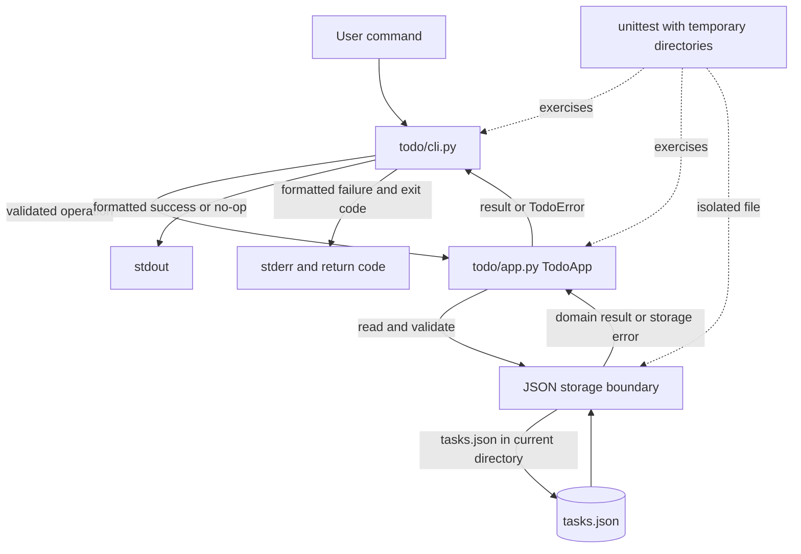

# Architecture

## Overview

The Todo CLI is divided into a command-line adapter, an application layer, and a local JSON storage boundary. The design stays within the four implementation-owned files in the contract. The pipeline remains independent of this sample story; only the implementation phase's declared outputs are story-specific.

## Components and responsibilities

- `todo/cli.py` parses the five supported command forms, dispatches to the application, formats the required output, writes errors to stderr, and returns the specified exit code. Its callable entry point accepts injectable arguments, streams, and app instance so tests can exercise it without process-global I/O.
- `todo/app.py` defines the `Task` data class, `TodoError` hierarchy, and `TodoApp` operations. It owns title validation, ID validation, task-state transitions, task ordering, and translating storage data to domain results. It does not print or inspect `argv`.
- The storage responsibility is implemented within `todo/app.py` because the contract permits no additional application module. It reads and validates `tasks.json`, constructs changed state, and persists successful mutations atomically. Listing and domain operations are kept separate from CLI formatting.
- `todo/__init__.py` supplies the package docstring and has no runtime responsibility.
- `tests/test_todo.py` uses `unittest` and temporary directories to check each FR and relevant NFR without sharing data with the user's current directory.

## Data model and persistence

`tasks.json` is in the process current working directory. Its top-level object contains `next_id` and `tasks`; each task record contains `id`, `title`, and `status`. IDs are positive integers allocated from `next_id`; status is `open` or `done`. The stored list order is creation order. Deleting a task removes its record but does not reduce or recycle `next_id`.

If the file is missing or empty, the storage boundary supplies an empty collection with the next ID set to 1. Existing JSON is parsed and validated before any mutation. Invalid JSON, invalid field types, or duplicate IDs produce `CorruptStorageError` while preserving the original bytes. Other filesystem failures produce `StorageError`.

For a successful mutation, the application changes an in-memory candidate state and writes it to a temporary file in the same directory. It serializes UTF-8 JSON with `ensure_ascii=False` and two-space indentation, flushes and fsyncs the temporary file, preserves the existing file mode where applicable, then replaces `tasks.json` atomically. A failed save removes the temporary file and does not report the operation as successful. Listing, no-ops, validation failures, and storage failures do not rewrite task data. No concurrency or simultaneous-writer guarantee is specified.

## Control/data flow

1. `python -m todo.cli` passes command arguments to the CLI adapter; `main(argv, stdout, stderr, app)` validates command shape and selects an application operation.
2. The application reads and validates current storage for the requested operation. `list` returns tasks in their stored creation order; an empty collection is returned as empty without writing.
3. For `add`, the application rejects a blank title, trims only surrounding whitespace, allocates `next_id`, and creates an `open` task. For `done` and `reopen`, it checks the ID and current status before making a transition. For `delete`, it removes only a found task.
4. If an operation is a successful change, the application persists the new candidate state atomically. If it is a no-op or failure, it leaves stored bytes unchanged.
5. The CLI formats successful results and no-op messages on stdout. It formats operation errors on stderr and maps usage errors to exit code 2; task-not-found errors use exit code 1.

## Mermaid diagram

## Decisions

- **Separate command I/O from task behavior.** The CLI adapter owns parsing and formatting while `TodoApp` owns task rules, so the app never prints or reads `argv` and CLI behavior can be tested through injected streams. This satisfies FR-001, FR-004 through FR-018, and NFR-006.
- **Keep the storage boundary inside the application file.** The contract limits implementation to four files and names `todo/app.py` as the application module; keeping storage private to this module avoids adding files while preserving a clear responsibility. This satisfies FR-020 through FR-024 and NFR-002 through NFR-004.
- **Persist the next ID independently of current task records.** IDs are allocated monotonically from `next_id`, so deletion cannot make a prior ID available again. This satisfies FR-018, FR-020, and FR-024.
- **Validate before writing and replace atomically.** Parse and validate current bytes first, mutate a candidate state, then use a same-directory temporary file and atomic replacement only for a successful change. This protects corrupt input and makes no-op/error byte preservation testable. This satisfies FR-008, FR-010, FR-012, FR-016, FR-021 through FR-023, and NFR-003 through NFR-004.
- **Use only local standard-library facilities.** The design requires no external service or runtime package and does not transmit or expose task data. This satisfies NFR-001 and NFR-005.
- **Do not promise concurrency or performance behavior.** Those requirements were explicitly left unspecified; the architecture introduces no lock, throughput target, or latency guarantee. This preserves the approved scope.

## Error handling

- Invalid command shapes are handled by the CLI adapter as usage errors: print usage text beginning with `USAGE` and return 2.
- A blank title is rejected before persistence. Invalid IDs are treated as not found. A missing task produces `TaskNotFoundError`; the CLI writes `Error: task <id> not found.` to stderr and returns 1.
- A valid status transition changes only the requested task. Repeating `done` on a done task or `reopen` on an open task returns the specified no-op message without saving.
- Corrupt JSON or invalid/duplicate stored records raise `CorruptStorageError`; other storage I/O problems raise `StorageError`. The CLI reports failures on stderr with a non-zero operation-error status. A failed atomic save cleans up its temporary file and does not claim success.
- The CLI entry point is independently callable and returns an integer; process invocation translates that result to the process exit code outside the callable entry point.

## Requirement coverage table

| Requirement | Component | Coverage |
|---|---|---|
| FR-001 | CLI adapter | Parses the five command forms and rejects malformed forms. |
| FR-002 | CLI adapter, TodoApp | Adds and returns the created task result. |
| FR-003 | TodoApp | Creates tasks in `open` state. |
| FR-004 | CLI adapter | Formats the required Added line on stdout. |
| FR-005 | TodoApp, CLI adapter | Returns and displays stored tasks in creation order. |
| FR-006 | TodoApp, CLI adapter | Returns empty result and displays `No tasks.`. |
| FR-007 | TodoApp | Transitions an existing open task to done. |
| FR-008 | TodoApp, storage boundary, CLI adapter | Detects already-done no-op and does not save. |
| FR-009 | TodoApp | Transitions an existing done task to open. |
| FR-010 | TodoApp, storage boundary, CLI adapter | Detects already-open no-op and does not save. |
| FR-011 | TodoApp, storage boundary | Removes a found task and persists the successful change. |
| FR-012 | TodoApp, CLI adapter | Reports not-found to stderr, returns 1, and does not save. |
| FR-013 | TodoApp | Treats malformed, zero, and negative IDs as not found. |
| FR-014 | CLI adapter | Emits usage text and returns 2 for command-shape errors. |
| FR-015 | CLI adapter, error hierarchy | Routes operation errors to stderr with non-zero exit status. |
| FR-016 | TodoApp | Rejects blank titles before creating or saving a task. |
| FR-017 | TodoApp | Trims title edges while preserving interior whitespace. |
| FR-018 | TodoApp, storage boundary | Allows duplicate titles while assigning distinct IDs. |
| FR-019 | TodoApp | Adds no product-defined title-length or task-count restriction. |
| FR-020 | Storage boundary | Reads and writes the defined current-directory JSON schema. |
| FR-021 | Storage boundary | Treats missing or empty data as an empty task collection. |
| FR-022 | Storage boundary, error hierarchy | Detects corrupt content and preserves original bytes. |
| FR-023 | Storage boundary, error hierarchy | Distinguishes other I/O failures as `StorageError`. |
| FR-024 | TodoApp, storage boundary | Persists monotonic `next_id` and never reuses deleted IDs. |
| NFR-001 | Whole application | Uses Python 3.11+ and standard-library modules only. |
| NFR-002 | Storage boundary | Emits UTF-8 JSON with non-ASCII preserved and two-space indentation. |
| NFR-003 | Storage boundary | Uses same-directory temporary file, flush/fsync, mode preservation, atomic replace, and cleanup. |
| NFR-004 | TodoApp, storage boundary | Writes only after successful changes; read/no-op/error paths preserve bytes. |
| NFR-005 | Whole application | Operates locally without network calls or secret handling. |
| NFR-006 | Tests and CLI/app interfaces | Supports requirement-tagged unittest coverage in isolated temporary directories. |