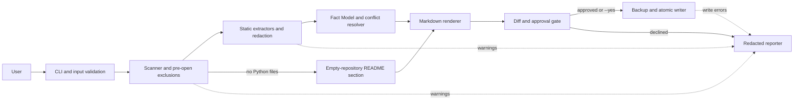

# Automated Documentation Sync Architecture

**Status:** Approved by user; awaiting explicit go before design review  
**Requirements:** [docs/requirements.md](requirements.md)  
**Selected approach:** Option A, a simple modular static-analysis pipeline

## Architecture Overview

The tool is a local command-line application organized as a linear pipeline:

`Scanner -> Extractors -> Fact Model -> Renderer -> Diff/Approval -> Writer`

The CLI validates the selected local repository or folder and coordinates the pipeline. Source code is parsed statically; repository modules are never imported or executed. Extracted facts retain source provenance so missing values can be marked `Not Found` and disagreements can be reported as `Conflicts`. The writer updates only approved generated sections in the root `README.md` and `docs/api.md`, backing up each original to a same-folder `<filename>.bak` before writing.

## Component Diagram



## Data Flow

```mermaid
sequenceDiagram
    actor User
    participant CLI
    participant Scanner
    participant Extractors
    participant Facts as Fact Model
    participant Renderer
    participant Gate as Diff/Approval
    participant Writer

    User->>CLI: Local path and optional --yes
    CLI->>Scanner: Validated repository root
    Scanner->>Scanner: Enumerate allowed inputs; exclude sensitive paths
    alt No Python files
        Scanner->>Renderer: Empty-repository README section only
        Renderer->>Gate: README change
        Note over CLI,User: Write approved README section, print clear non-error message, exit
    else Python files found
        Scanner->>Extractors: Eligible files
        Extractors->>Facts: Verified values with file and line provenance
        Facts->>Facts: Resolve missing fields and conflicts
        Facts->>Renderer: Resolved documentation facts
        Renderer->>Gate: Proposed README and API changes
        Gate-->>User: Redacted diff
        alt --yes supplied
            Gate->>Writer: Authorized changes
        else interactive approval
            User->>Gate: Approve or decline
            Gate->>Writer: Changes only when approved
        end
        Writer->>Writer: Copy originals to same-folder .bak, then atomically replace files
        Writer-->>User: Completion status and sanitized warnings
    end
```

## Components and Requirement Mapping

| Component | Responsibilities | Requirement IDs |
| --- | --- | --- |
| CLI and input validation | Accept a local path and optional `--yes`; reject invalid paths and non-local inputs; start one on-demand run. | FR-01, FR-07, NFR-04 |
| Scanner | Walk the repository once; identify Python and supported config/README inputs; exclude `.env`, `*.key`, `*.pem`, `credentials*`, tests, CI files, and commit history from extraction. If no Python files exist, route to the empty-repository README path. | FR-01, FR-05, NFR-01, NFR-02, NFR-03 |
| Extractors | Parse Python source and supported config formats without executing project code; extract README facts, API signatures/docstrings, dependencies, entry points, and config variable names; discard token/password/API-key values before facts are retained. | FR-01, FR-02, FR-03, FR-05, NFR-01 |
| Fact Model and conflict resolver | Store each fact with source path and line provenance; merge evidence; produce `Not Found` for unverifiable fields and `Conflicts` notes for contradictory facts. | FR-04, FR-05, NFR-03 |
| Markdown renderer | Render README and API-reference sections from resolved facts; for no-Python inputs, render only the required empty-repository README section and no API document. | FR-02, FR-03, FR-04, FR-05 |
| Diff/Approval gate | Always show the proposed diff; obtain interactive approval unless `--yes` was supplied; make no changes after a decline. | FR-06, FR-07, NFR-04 |
| Backup and atomic writer | Before writing, copy the original to `<filename>.bak` in the same folder, replacing any older backup; update only the generated marker region or append a new marked section when markers are absent; write through a temporary file and replace atomically. | FR-06, NFR-03 |
| Redacted reporter | Report skipped/malformed files and write failures without including file contents, token values, or passwords. | FR-05, NFR-01, NFR-03, NFR-04 |

## Technology Choices

| Area | Choice | Justification |
| --- | --- | --- |
| Runtime and CLI | Python 3.11+ with standard-library `argparse` and `pathlib`. | Meets the repository's Python rule, supports local paths, and avoids a CLI framework dependency for a small manual tool. |
| Python API extraction | Standard-library `ast` and `tokenize`; never import or execute target modules. | Retrieves modules, public declarations, signatures, and docstrings while avoiding execution of untrusted repository code. `__all__` and leading-underscore conventions define public names; ambiguous exports remain unverified. |
| TOML and JSON | `tomllib` and `json` from the standard library. | Native parsers are sufficient for the specified formats and need no additional dependencies. |
| YAML and requirements | `PyYAML` with `safe_load`, and `packaging.requirements.Requirement`. | Safe YAML parsing avoids arbitrary object construction; `packaging` validates standard dependency specifiers. Unsupported requirements-file directives are warned about rather than guessed. |
| Fact representation | Small typed records containing field, value, source path, and line. | Keeps provenance available for conflicts, review, and `Not Found` decisions without retaining the whole repository. |
| Markdown generation | Project-owned templates and deterministic escaping; standard-library `difflib` for unified diffs. | Keeps output format and marker behavior explicit, reviewable, and independent of an external service. |
| Safe writes | Standard-library `shutil.copy2`, `tempfile`, and `os.replace`. | Keeps the latest same-folder `<filename>.bak` and atomically replaces a target after approval. |
| Tests | `pytest`. | Matches the repository-wide testing rule; tests verify parsing, redaction, conflicts, approval, and marker preservation. Tests are not used as documentation inputs. |

## Error Handling

- Validate the input root before scanning. Invalid or inaccessible roots produce a concise error and no output changes.
- Handle read, decoding, and parse failures per file. Emit a sanitized warning, skip that file, mark dependent facts `Not Found`, and continue scanning.
- When sources disagree, preserve both non-sensitive values and their provenance in a `Conflicts` note. Redact sensitive values in the note.
- If the folder contains no Python files, append a README section stating `Repository is empty or contains no supported files`, do not generate an API document, print a clear non-error message, and exit successfully.
- If the user declines a diff, leave targets and backups unchanged. If backup or atomic replacement fails, preserve the original and report the failure without exposing content.
- If a target has no markers, append a new `<!-- doc-sync:start -->` / `<!-- doc-sync:end -->` section without changing existing content. Update only content inside one valid marker pair.
- If markers are unmatched, duplicated, or malformed, refuse to modify that target and continue with any independent output that can be safely updated.
- Before a write, copy the original to `<filename>.bak` in the same folder. Replace the previous `.bak` so only the latest backup remains.

## Security Approach

- All processing is local. The application has no network client, hosting-platform integration, authentication flow, or GitHub API call.
- Apply filename exclusions before opening files: `.env`, `*.key`, `*.pem`, and filenames beginning with `credentials`. Do not read token environment variables.
- Parse Python statically; never import or execute target code. Parse YAML with `safe_load`.
- Before a value enters the Fact Model, screen it for token, password, and API-key patterns. Discard matching values; do not store them or write them, partially masked, to generated documents, diffs, backups, warnings, or logs. Mark an affected documentation field `Not Found` or omit the sensitive configuration value.
- Screen existing output files before producing a diff or backup. If a secret-like value is found, refuse to update that target and report only its path, so the value is not copied into a backup or diff.
- Keep permitted-file screening local and transient. Sensitive files excluded by name are never opened, and token environment variables are never read.

## Future Extensions

The extractor interface can later support plugins for additional source or configuration formats. Version 1 uses only the built-in Python and config extractors; plugin discovery is not part of this design.

## Final Decisions

- Generated sections use `<!-- doc-sync:start -->` and `<!-- doc-sync:end -->`. If neither marker exists, append a new marked section and preserve all existing content. If markers are unmatched, duplicated, or malformed, refuse to update that target.
- Before each write, copy the original file to `<filename>.bak` in the same folder. Replace any previous `.bak`; keep only the latest backup.
- If no Python files are found, append `Repository is empty or contains no supported files` as a short README section, skip API generation, print a clear non-error message, and exit successfully.
- Skip `.env`, `*.key`, `*.pem`, and `credentials*` files by filename. Discard values matching token, password, or API-key patterns before they enter the Fact Model. Never write matching or partially redacted values to outputs or logs.
- Always show a redacted diff. `--yes` skips the interactive approval prompt, not the diff.
- If an existing output contains a secret-like value, refuse to produce its diff, backup, or update; report only the file path.